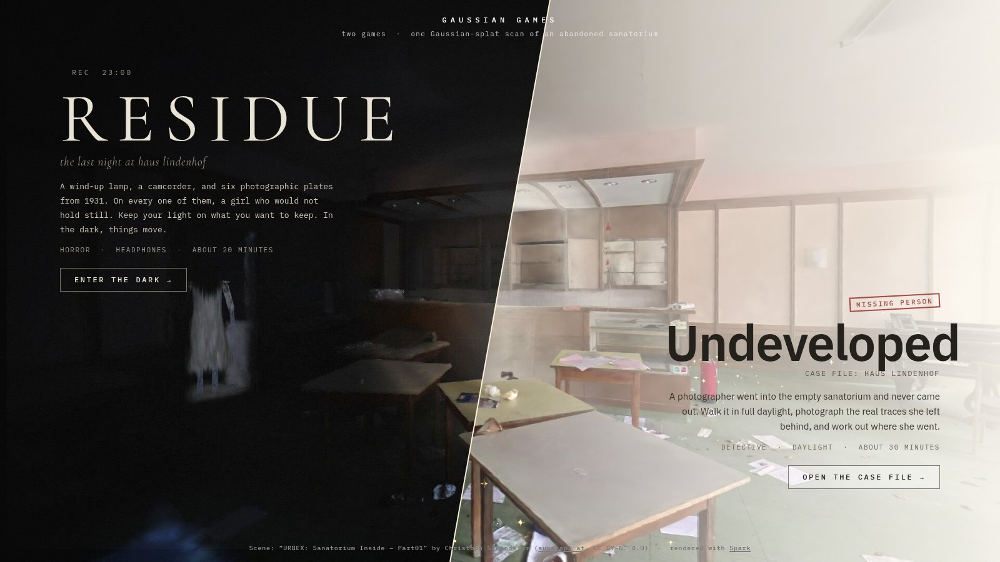
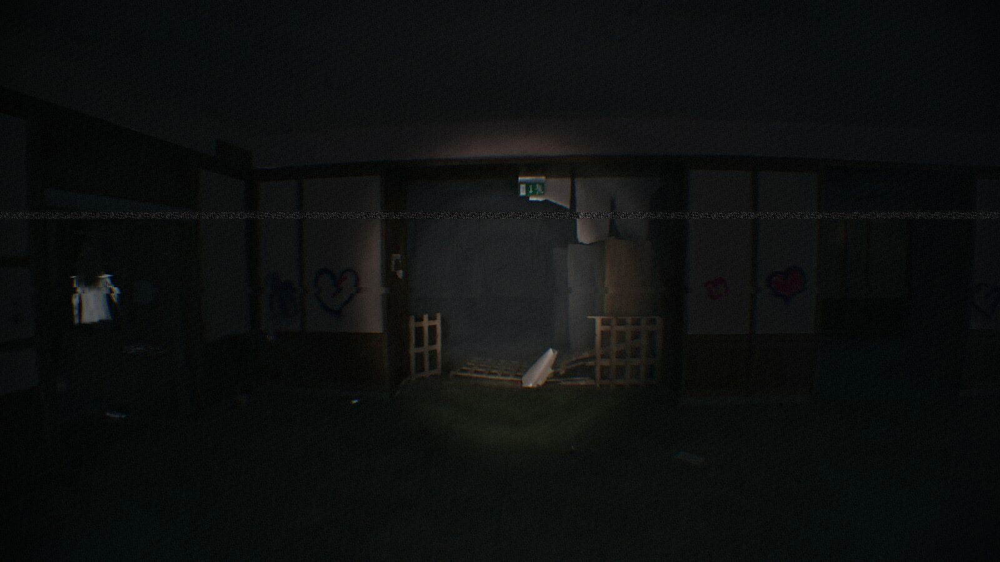
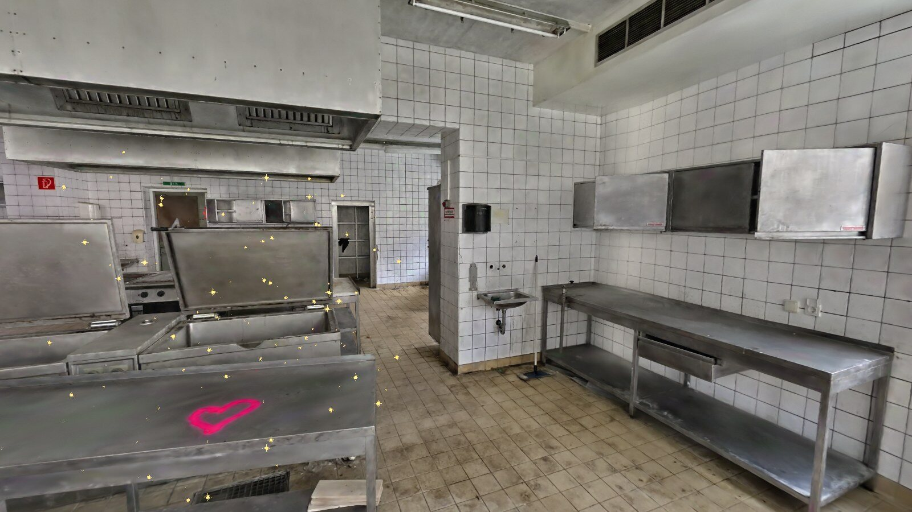

# Gaussian Games

Two first-person browser games built on **one Gaussian-splat scan** of an abandoned sanatorium. They use the same 12.5 million splats, in the same building, but one game plays at night and the other in daylight.



| | |
| --- | --- |
| **RESIDUE** · horror · ~20 min | **Undeveloped** · detective · ~30 min |
|  |  |
| It is the last night before demolition. In 1931 a doctor photographed the patients here by lamplight, in exposures so long that only those who held still came out clear. One girl never held still. You go in with a wind-up lamp and a camcorder to find his six plates. | A photographer went into the empty sanatorium and never came out. Walk it in full daylight, photograph the real traces she left behind, and work out where she went. |

## Running it

```bash
npm install
npm run assets -- "URBEX Sanatorium Inside - Part01.zip"   # once, see below
npm run dev
```

Open the printed URL in Chrome, Edge or Firefox on a desktop with a dedicated GPU. Wear headphones for RESIDUE. The menu at `/` links to both games, which are also at `/residue.html` and `/undeveloped.html`.

**The scan is not in this repository.** Download *URBEX: Sanatorium Inside – Part01* by Christoph Schindelar from [superspl.at](https://superspl.at/scene/8429e5e2) (CC BY-NC 4.0). `npm run assets` turns the zip into what the games load:
- a cropped, cleaned SPZ of every splat (~215 MB);
- a level-of-detail tree for weaker GPUs;
- a 10 cm collision voxel grid.

It needs Python 3, Rust/cargo (to build Spark's `build-lod`) and about 10 GB of scratch disk.

### RESIDUE

| Key | Action |
| --- | --- |
| WASD / Shift / C | walk / run / crouch |
| F or right-click | lamp on / off |
| R (hold) | wind the lamp (only in the dark, and loud) |
| M (or Esc) | menu |

- **Goal:** find the six plates and hold your lamp on each until it develops. They glow faintly on the floor, best seen in the dark.
- **The lamp:** it runs down in about 30 seconds. Winding it back up means standing in the dark, making noise.
- **Her:** something in the building moves only in the dark. Light holds her still, and enough of it burns her away.

Extras:
- `H` turns the camcorder filter on and off (remembered); `?clean` starts without it.
- `?lod` uses the lighter level-of-detail scene for weaker GPUs.
- `?detail=1.2` fixes the splat budget instead of adapting it to your frame rate.
- `?debug` (both games) exposes the game state on `window` and turns on `P` for a freeze frame.

### Undeveloped

| Key | Action |
| --- | --- |
| WASD / Shift | walk / run |
| right mouse | raise / lower the camera |
| left mouse | take a photo |
| E | look closer / read |
| Tab | case notebook |
| M (or Esc) | menu |

- **Real evidence:** every clue is an actual object in the scan (a window frame on the floor, a pink heart traced over in blue, a dog bowl on the terrace), and the photos in your notebook are the frames you took.
- **Deduction:** the notebook poses each chapter as statements with blanks, which you fill with evidence and keywords. A chapter is only confirmed when every statement holds.

## How the splat is used

Everything is derived from the capture itself. There are no meshes and no hand-made collision.

- **Relighting** (`src/lighting.js`): RESIDUE patches Spark's splat vertex shader. Each splat's baked colour is treated as albedo and relit per frame:
  - by a hand lamp (core, ring and spill, which dims and goes orange as it runs down);
  - by a cold moonlight that survives only in the brightest splats (the windows);
  - by a failing bulb in the stairwell, occluded by a line-of-sight volume baked from the voxel grid.

  Shading in the vertex shader means turning your head never regenerates the splat buffer.
- **Collision and navigation** (`tools/voxelize.py`, `src/world.js`): splats are binned into an opacity-weighted 10 cm voxel grid. Floors are solid cells with free headroom above them. From the same grid come the player's walkable surfaces (stairs included), a nav graph with clearance-aware A* for the entity, and the line-of-sight tests.
- **The plates:** patches of the real floor are shown as a glowing photographic negative. Under the lamp they develop into a warm positive with a smeared figure in it.
- **Mara's footprints** (`src/case/trail.js`): in Undeveloped, splat shoe prints in pale dust are laid along a nav route to the stairwell, on the real floor and steps.
- **The edge of the world** (`src/case/boundary.js`): where the capture runs out, splats ripple and dissolve, into black fog at night and into overexposed haze by day, driven by a distance field baked from the nav graph.
- **The entity** (`src/figure.js`, `src/entity.js`):
  - **Body:** about 16,000 procedural Gaussians with a body-part ID packed into each splat's colour bits, posed on the GPU by a Spark dyno modifier.
  - **Movement:** a broken-legged gait, stalking and hunting body language, and sprint charges, shown in stop-motion.
  - **Face:** a head that smears like a long exposure.
  - **The lamp:** it freezes her and burns her away splat by splat.
- **The camcorder** (`src/camcorder.js`): a post pass over the splat render adds barrel distortion, colour fringing, auto-gain noise, lagging auto-exposure, autofocus hunting and interference, together with handheld sway on the camera.
- **Sound:** nearly all of it is procedural WebAudio:
  - HRTF-positioned footsteps;
  - the entity's running steps;
  - a wind-up lamp's ratchet;
  - the bulb's hum;
  - the detuned piano in the dining hall;
  - Undeveloped's gentle score (`src/case/music.js`): Karplus-Strong harp, pads and bass in slow major-key sections with rests between them.

## Performance

RESIDUE draws all 12.5M splats without LoD. On an RTX 2070 at 1080p it runs at about 55-60 fps. The render settings in `src/render-config.js` were tuned with a headless benchmark:
- `tools/fitness.mjs` scores frame time and image quality against a high-budget reference;
- `tools/search.mjs` runs an evolutionary search over the settings.

Both need `tools/bench-server.sh start`.

## Repository layout

```
index.html            menu (split screen)
residue.html          RESIDUE
undeveloped.html      Undeveloped
src/                  RESIDUE: main loop, lighting, entity, camcorder, audio, player, world
src/case/             Undeveloped: game, case content, daylight view, edge of the world
public/menu/          menu images
tools/                asset pipeline (Python, Spark build-lod), benchmark and authoring tools
docs/                 README images
```

## Credits

- **Scene:** ["URBEX: Sanatorium Inside – Part01"](https://superspl.at/scene/8429e5e2) by Christoph Schindelar, licensed [CC BY-NC 4.0](http://creativecommons.org/licenses/by-nc/4.0/). Because of that licence, this project is **non-commercial**.
- **Renderer:** [Spark](https://sparkjs.dev) by World Labs, on [three.js](https://threejs.org).
- **Sound:** RESIDUE's breathing is ["breathing tired"](https://opengameart.org/content/breathing-tired) by mikeask (CC0). All other sound, including Undeveloped's music, is synthesised.
- **Story:** the stories, people and documents in both games are fiction.
